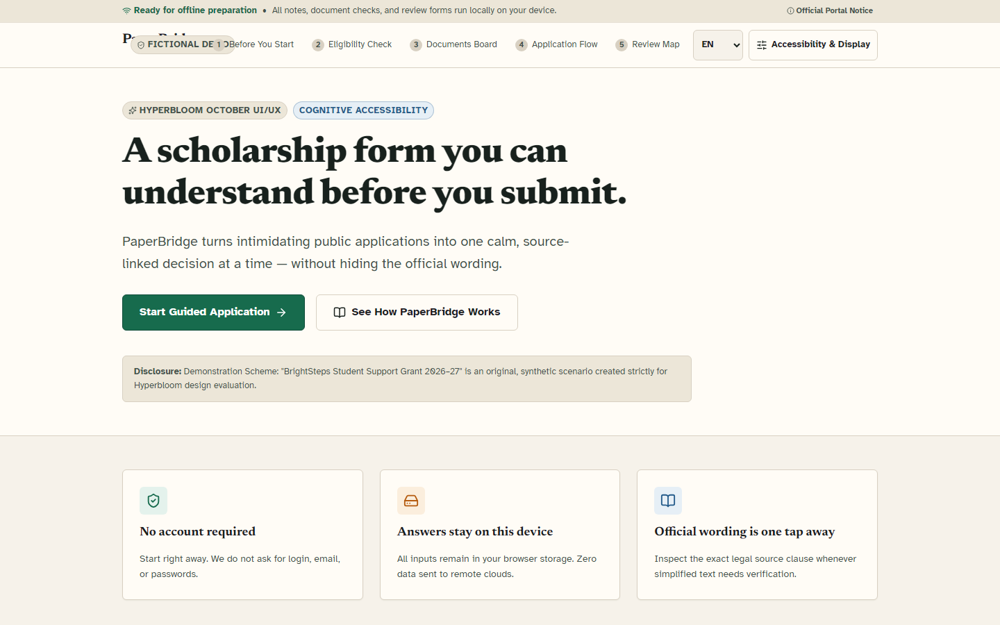
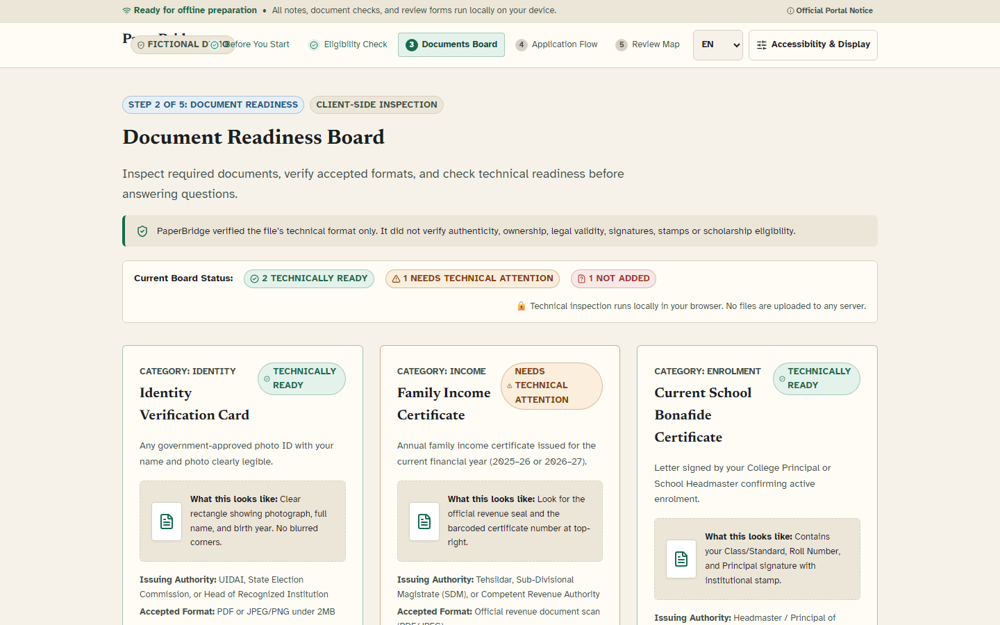
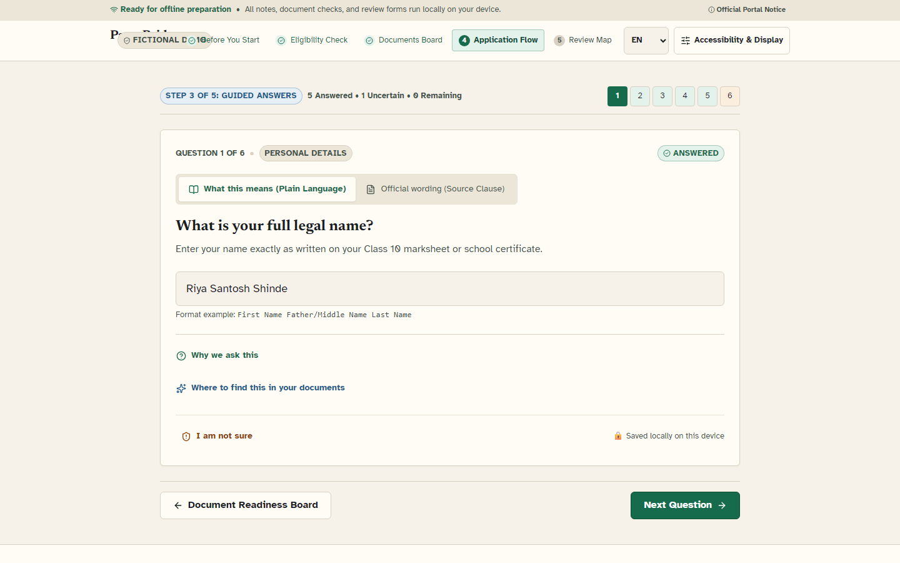
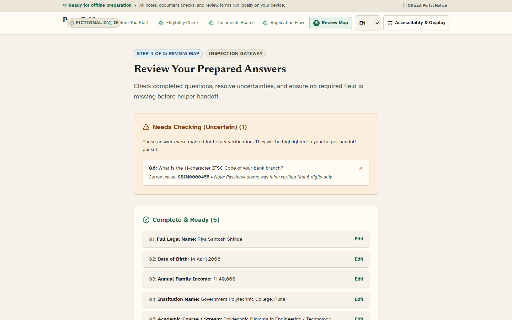
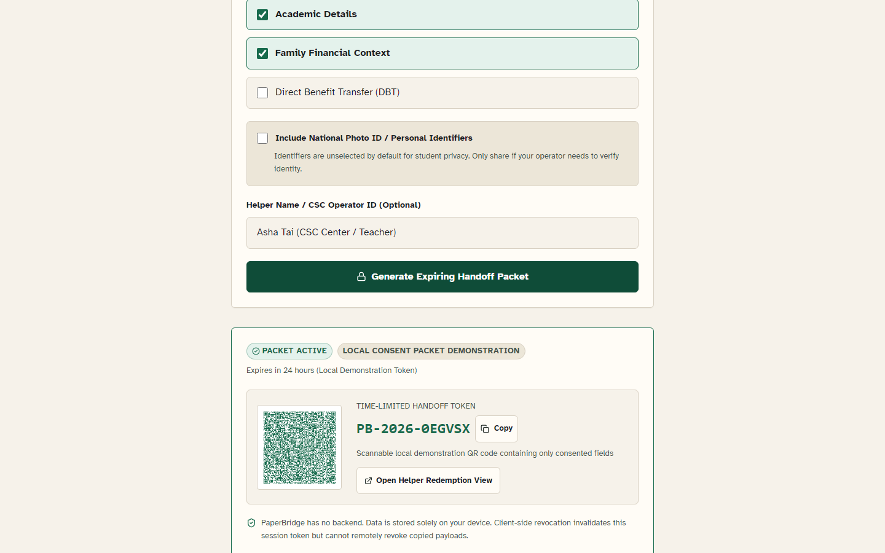
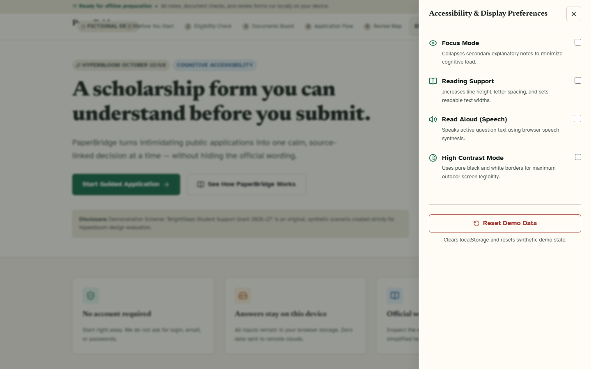

# PaperBridge — Public forms that explain themselves

> **A consent-first, cognitively accessible interface that turns intimidating scholarship applications into a source-linked, one-decision-at-a-time journey without hiding the official wording.**

Built with care for **Hyperbloom October — UI/UX and Web Design** by **Team MetaMask** (Abhijeet Nardele, Student, Age 18, India).

---

## 📸 Interface Walkthrough

| 1. Landing & Signature Interaction | 2. Document Readiness Board |
| :---: | :---: |
|  |  |
| *Three honest promises & live dual-layer preview* | *Readiness status, synthetic specimens & inspection* |

| 3. One-Decision Application Flow | 4. Tri-Partition Review Map |
| :---: | :---: |
|  |  |
| *Plain Meaning ↔ Statutory Official Wording toggle* | *Complete, Needs Checking & Missing partitions* |

| 5. Consent-Controlled Helper Handoff | 6. Accessibility & Display Preferences |
| :---: | :---: |
|  |  |
| *Selective permission, expiring token & instant revoke* | *Focus Mode, Reading Support, Read Aloud & High Contrast* |

---

## 💡 The Core Problem: Administrative Exclusion

Every year, thousands of eligible first-generation students miss out on higher secondary and diploma scholarships. The barrier is rarely eligibility—it is procedural intimidation. 

Statutory government application forms reflect internal departmental taxonomy rather than the mental model of an 18-year-old student. Applicants face 40-field dense grids, penal declarations, and legalistic phrasing such as *"Gross aggregate annual income of the paternal guardian from all statutory sources including agricultural rents under Clause 4(b)"*.

When applicants don't understand what is asked, existing digital systems force two bad choices:
1. **Forced Guesswork:** Portals mandate binary choices, turning uncertainty into perjury anxiety or silent disqualification.
2. **Total Surrender of Privacy:** Students hand over their unlocked phones, passwords, and original documents to commercial cyber-café operators just to complete basic forms.

PaperBridge was created to provide a calm, sovereign, and source-linked preparation experience.

---

## ✨ The Five Signature Verbs of PaperBridge

1. **Know (Preparation Contract & Triage):**
   - 4-question eligibility triage with zero dead ends. If a student is ineligible, PaperBridge explains the exact rule and suggests supportive alternatives.
   - Upfront transparency: required documents, offline capabilities, expected completion time (~12 mins), and explicit disclosure of what PaperBridge does vs does not do.
2. **Prepare (Document Readiness Board):**
   - Visual synthetic cards for Identity, Income, Bonafide Enrolment, and Bank Proof.
   - Clear status badges (Ready, Needs Attention, Missing), format specifications, and mock inspection feedback.
3. **Answer (The Signature Dual-Layer Interaction):**
   - **What this means:** Simple language, practical examples, and forgiving inputs.
   - **Official wording:** Verbatim statutory clause citations (e.g., Section 3.1(a)) explaining *why* the government asks for this information.
   - **Uncertainty as a First-Class State:** Dedicated *"I am not sure"* button that provides contextual evidence hints without blocking progression or penalizing the applicant.
4. **Check (Review Map):**
   - Tri-partitioned overview: **Complete & Ready**, **Needs Checking (Uncertain)**, and **Missing Required Questions**.
   - Direct 1-click return links to exact questions with full state preservation.
5. **Hand Off (Consent-Controlled Helper Share):**
   - Selective sharing checklist where personal national identity documents are unselected by default.
   - Time-limited local token (`PB-2026-XXXXXX`) and QR representation for village operators or teachers.
   - Working 1-click revocation to immediately invalidate helper access.

---

## 🏛️ Non-Impersonation Boundary & Ethical Principles

- **No False Government Submission:** PaperBridge does not pretend to submit directly to state servers or decide legal awards.
- **Exact Completion Mandate:**
  > *"Your PaperBridge preparation is complete. Continue on the official portal."*
- **Client-Side Sandbox:** All answers and preferences remain exclusively within the student's browser (`localStorage`). Zero analytics, zero telemetry beacons, zero remote tracking.
- **Synthetic Demonstration Scenario:** Uses the fictional *"BrightSteps Student Support Grant 2026–27"* scenario created strictly for Hyperbloom design evaluation.

---

## ♿ Accessibility & Universal Design (WCAG 2.2 AA)

- **Automated Audit:** **0 critical, 0 serious axe-core violations** verified across all 9 routes via `@axe-core/playwright`.
- **Contrast Ratios:** Primary ink on paper achieves **14.2:1** (exceeds WCAG AAA); warning saffron achieves **6.6:1** AAA against light surfaces.
- **Keyboard Operability:** Universal skip link (`.skip-link`, `Alt+S`), 2px visible focus ring, no keyboard traps.
- **Reflow & Responsive Design:** Verified zero horizontal scroll across 320px, 360px, 768px, 1024px, 1440px, and 1920px viewports.
- **Cognitive Accessibility Modes:**
  - **Focus Mode:** Hides secondary metadata to minimize distraction.
  - **Reading Support:** Increases line height to 1.9 and constrains measure to 60ch.
  - **Native Read Aloud:** Speaks question text using native browser `window.speechSynthesis` without cloud latency.
  - **High Contrast Mode:** Pure black-on-white palette with 2px borders.
- **Multilingual Support:** Complete localization for **English**, **हिन्दी (Hindi)**, and **मराठी (Marathi)**.

---

## 🧪 Verified Test Suite & Verification Metrics

All metrics below reflect real, automated and reproducible executions:

```text
✓ Vitest Unit & Component Suite:
  - 44 / 44 passed (100% test pass rate)
  - Strict coverage gates satisfied:
    * Statements: 87.04% (threshold: 85%)
    * Branches:   76.98% (threshold: 75%)
    * Functions:  86.08% (threshold: 85%)
    * Lines:      88.73% (threshold: 85%)

✓ Playwright Full E2E & Accessibility Suite:
  - 26 / 26 passed across 5 test suites (accessibility, documents, journey, offline, screenshots)
  - 0 serious or critical axe violations across all 9 primary routes
  - Viewports verified: 320x640, 360x740, 390x844, 430x932, 768x1024, 1024x768, 1440x900, 1920x1080
  - Zero horizontal overflow across all viewports

✓ Google Lighthouse 13.5.0 Audit Scores (Production Build):
  - Accessibility: 100 / 100
  - Best Practices: 100 / 100
  - Performance:    94 / 100
  - SEO:            91 / 100

✓ Privacy & Offline Reliability:
  - 100% self-hosted fonts via @fontsource/atkinson-hyperlegible and @fontsource-variable/newsreader
  - 0 external third-party network requests (verified 0 occurrences of fonts.googleapis/fonts.gstatic)
  - Service worker precaches 34 entries (828 kB) with cold offline reload verified
  - Handoff payload URL fragment isolation (#token=...&p=...) with 0 server transmission

✓ Static Engineering Quality:
  - TypeScript strict compile (tsc -b): 0 errors
  - Oxlint linter: 0 errors
  - Production bundle build: Code-split main bundle 490 kB (<500 kB threshold)
```

---

## 🚀 Local Setup & Verification

```bash
# Clone the repository
git clone https://github.com/abhijeetnardele24-hash/paperbridge.git
cd paperbridge

# Install dependencies
npm install

# Run development server
npm run dev

# Run unit tests
npm test

# Run end-to-end and accessibility tests
npx playwright test

# Build production bundle
npm run build
```

---

## 🚢 Deployment Configuration (Deployxa)

PaperBridge is configured for static hosting with client-side SPA routing:
- `deployxa.json`: Framework and build output configuration (`dist`).
- `public/_redirects`: Universal rewrite rule (`/* /index.html 200`).

To deploy via the Deployxa CLI:
```bash
npx deployxa deploy
```

---

## 📚 Research & Standards Citations
- **W3C Web Accessibility Initiative (WAI):** [WCAG 2.2 Guidelines](https://www.w3.org/TR/WCAG22/)
- **W3C COGA Task Force:** [Making Content Usable for Cognitive and Learning Disabilities](https://www.w3.org/TR/coga-usable/)
- **National e-Governance Division (NeGD) India:** [UX4G Design System](https://ux4g.gov.in/)
- **National Informatics Centre (NIC) India:** [Guidelines for Indian Government Websites (GIGW 3.0)](https://guidelines.gov.in/)
- **UK Government Digital Service:** [GOV.UK Service Manual: Question Pages Pattern](https://design-system.service.gov.uk/patterns/question-pages/)
- **OECD:** [Recommendation on Digital Government Strategies](https://www.oecd.org/gov/digital-government/recommendation-on-digital-government-strategies.htm)

---

## 📄 Licence & Team
- **Licence:** MIT License (see [LICENSE](LICENSE))
- **Team Name:** MetaMask
- **Solo Builder:** Abhijeet Nardele (Satara, Maharashtra, India)
