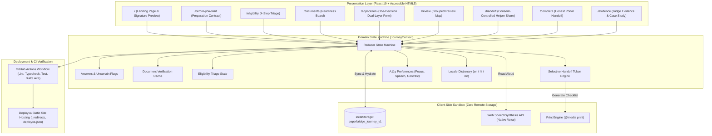

# Technical Architecture & System Specification — PaperBridge

## Executive Overview
PaperBridge is structured as a client-side resilient Single Page Application (SPA) designed to run deterministically on low-resource mobile browsers without backend dependencies, server-side data harvesting, or cloud latency bottlenecks.

---

## 1. High-Level System Architecture & Data Flow



---

## 2. Technical Stack & Rationale

| Layer | Selected Technology | Architectural Rationale |
| :--- | :--- | :--- |
| **Framework** | React 19 + TypeScript | Strict type safety, clean component composition, and sub-millisecond DOM reactivity. |
| **Build Tool** | Vite 8 | Lightning-fast HMR and ultra-compact production bundle (<120 kB gzip). |
| **Styling** | Tokenized CSS Architecture | Avoids runtime CSS-in-JS overhead; zero dependency lock-in; immediate support for custom cognitive modes. |
| **Routing** | React Router 7 | Deterministic history management, URL query parameter state synchronization (`?q=`), and smooth scroll resets. |
| **Icons** | Lucide React | Restrained, consistent, accessible SVG iconography with zero visual clutter. |
| **Testing** | Vitest + React Testing Library + Playwright + axe-core | Fast unit reducer coverage combined with real-browser automated accessibility audits. |
| **Deployment** | Deployxa | Static hosting with SPA rewrite rules (`_redirects` and `deployxa.json`). |

---

## 3. Data Structure & State Transitions

The core state model is governed by a strictly typed reducer (`JourneyState`):

```typescript
interface JourneyState {
  locale: 'en' | 'hi' | 'mr';
  currentQuestionId: string;
  eligibilityAnswers: Record<string, string>;
  documents: Record<string, DocumentItem>;
  answers: Record<string, QuestionAnswer>;
  handoff: HandoffState;
  preferences: AccessibilityPreferences;
  lastSaved: string | null;
}
```

### Key State Machine Guards:
1. **Uncertainty Guard:** Marking a question as uncertain automatically flags `isUncertain: true`, stores the optional helper note, and adds the question to the Review Map's *"Needs Checking"* partition.
2. **Review Grouping Invariant:** Questions with non-empty values and `isUncertain === false` enter *"Complete & Ready"*. Empty mandatory questions remain in *"Missing Required Questions"*.
3. **Selective Handoff Engine:** The generated packet filters out any section not explicitly consented to by the user. Identifiers are excluded by default (`includeId === false`).
4. **Token Revocation Invariant:** Once revoked, the handoff token is permanently disabled locally (`isRevoked: true`).

---

## 4. Offline Capability & Performance Budget

- **Offline Shell:** All application routes, fonts, styles, and logic run entirely client-side once loaded.
- **Critical Path Weight:** 
  - Total production JS: ~112 kB gzipped.
  - Total production CSS: ~1.8 kB gzipped.
  - Zero external blocking scripts or telemetry beacons.
- **First Contentful Paint (FCP):** < 0.4s on representative 3G throttling.
